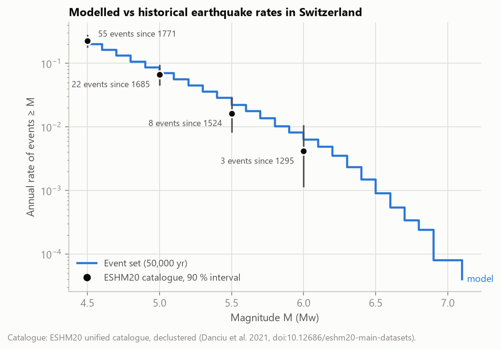
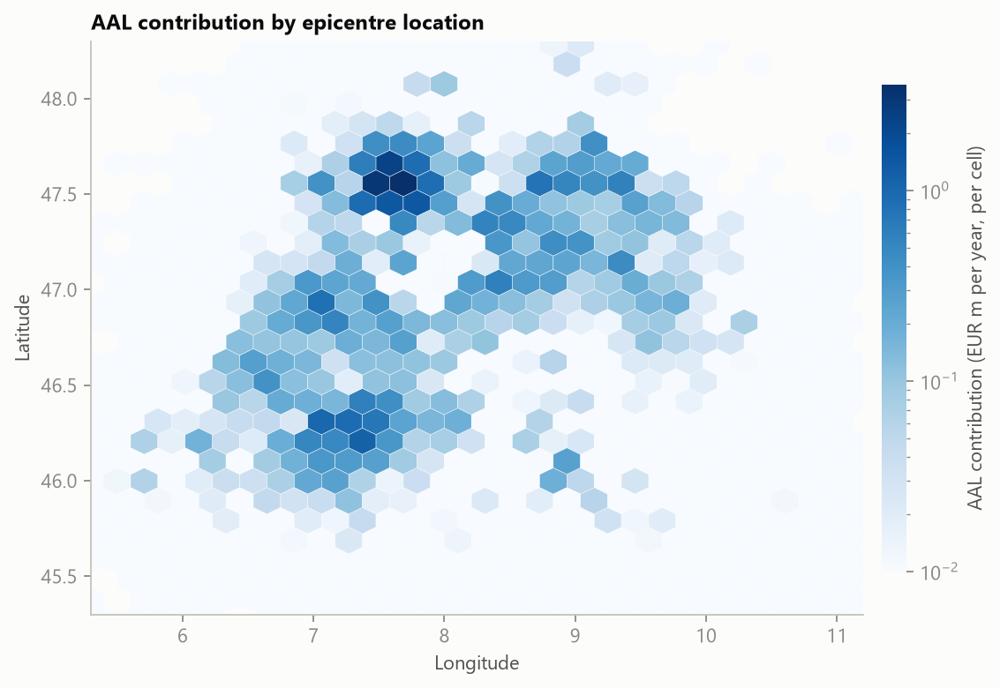
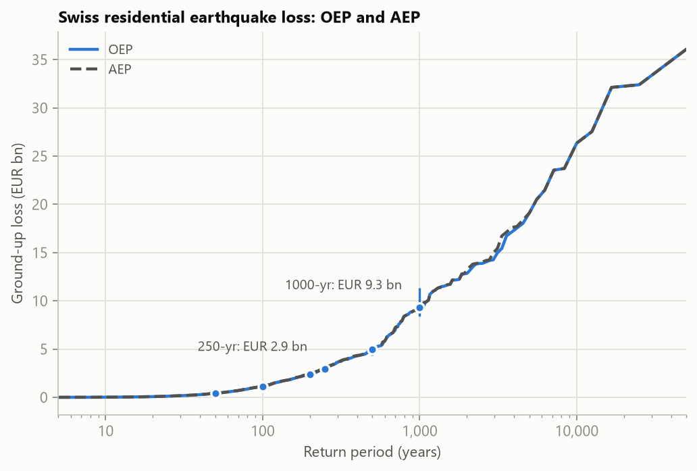
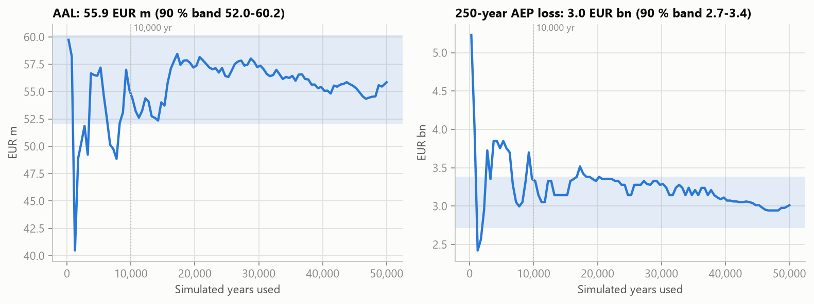
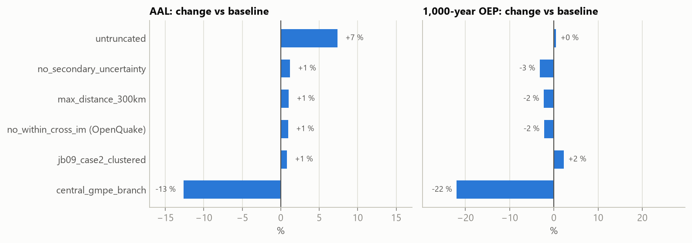
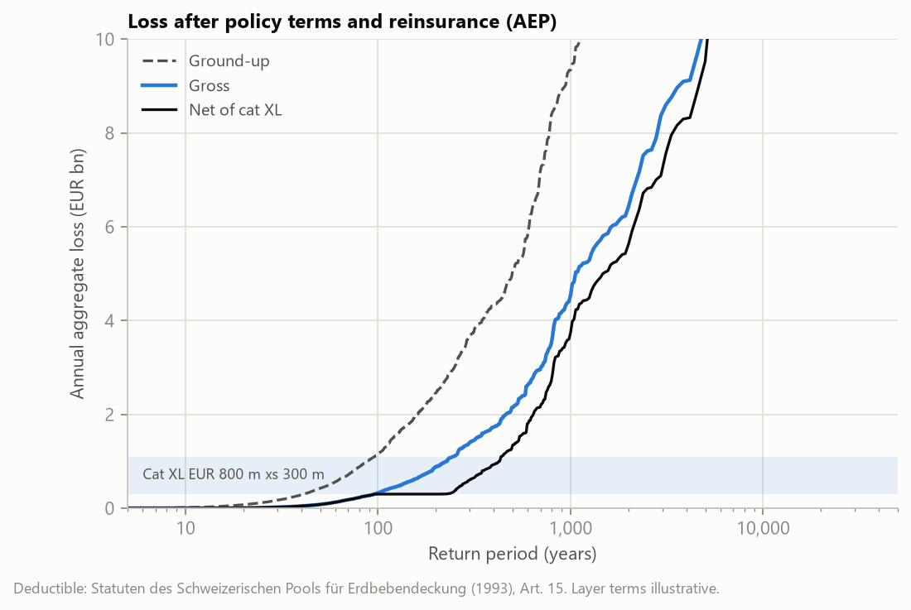

# chquake: an open earthquake loss model for Switzerland

> Work in progress. This is a portfolio project, not a production model.

A small, reproducible earthquake catastrophe model for Swiss residential buildings:

**hazard → site → exposure → vulnerability → financial terms → EP metrics**

The results are benchmarked against the published Swiss national earthquake risk model (ERM-CH23).
The aim is a transparent "own view of risk", not a calibrated replica.

## Status

| Milestone | Content | Status |
|---|---|---|
| M0 | Scaffold (packaging, lint, tests, licence) | done |
| M1 | Exposure + vulnerability (ESRM20) | done |
| M2 | Stochastic event set + ground motion, checked against the historical catalogue | done |
| M3 | Losses → ELT/YLT → AAL, OEP/AEP, convergence | done |
| M4 | Financial module (Swiss earthquake pool deductible) + cat XL layer | done |
| M5 | Benchmark against ERM-CH23 | planned |
| M6 | Final README, figures, limitations | planned |

## Quick start

```bash
# OpenBLAS instead of MKL: MKL 2026.1 crashed numpy's linear algebra on the dev machine (Windows)
conda create -n chquake -c conda-forge python=3.11 git pip "libblas=*=*openblas" -y
conda activate chquake
# OpenQuake's own pins clash with this environment, so install its dependencies from
# conda-forge and the engine itself without dependencies.
conda install -c conda-forge h5py toml decorator shapely pyproj numba psutil requests h3-py fiona openpyxl -y
pip install --no-deps openquake.engine==3.26.2 alpha_shapes==1.1.0
pip install -e ".[dev]"
# Windows: fiona needs GDAL_DATA, e.g. $env:GDAL_DATA="$env:CONDA_PREFIX\Library\share\gdal"
python scripts/download_data.py
pytest
python run.py --config config.yaml          # 50,000 years, ~5 min on a laptop
python scripts/historical_rates.py           # event set vs catalogue
python scripts/sensitivity.py                # one choice changed at a time, ~5 min per case
```

Figures are produced by `notebooks/01_results.ipynb` and saved to `docs/figures/`.

## Results so far (ground-up, EUR 2020, 50,000 simulated years)

| Metric | Loss (EUR bn) |
|---|---|
| AAL | 0.056 (90 % Monte Carlo interval 0.051–0.061) |
| 100-year OEP | 1.14 |
| 250-year OEP / AEP | 2.94 / 3.01 |
| 1,000-year OEP / AEP | 9.33 / 9.34 |
| 99 % expected shortfall (AEP TVaR at 100 years) | 4.14 |

For scale: the exposure is EUR 973.5 bn, so the AAL is about 0.06 ‰ of value. These numbers are
not yet compared with ERM-CH23 (M5); they are not tuned to any target.

**The event set reproduces the historical record.** The modelled annual rate of M ≥ 4.5–6.0
earthquakes in Switzerland lies inside the 90 % Poisson interval of the declustered ESHM20
catalogue at every threshold (model/observed: 0.89, 1.04, 1.36, 1.51). The model is above the
catalogue at M ≥ 5.5 and 6.0, but with only 8 and 3 historical events those counts are weak
evidence either way.



**The loss is concentrated around Basel.** High source rates next to a dense, valuable building
stock. The five largest simulated events all come from the Basel area source.



**OEP and AEP nearly coincide** because a damaging year almost always holds one dominant event.



**Convergence.** The AAL settles within its final 90 % band after about 16,000 years; the
250-year loss needs most of the 50,000. 10,000 years (the first trial) was too noisy for the tail.



**Sensitivity.** One choice changed at a time, all random draws identical (common random
numbers). The ground-motion model matters most: using only the central Kotha et al. (2020)
branch instead of sampling all 15 lowers the AAL by 13 % and the 1,000-year loss by 22 %, because
losses are convex in ground motion, so averaging over branches raises them. Removing the 3σ
truncation raises the AAL by 7 % but leaves the 1,000-year loss unchanged. The correlation
choices, the 300 km cut-off and secondary uncertainty each move the results by a few percent,
which is within Monte Carlo noise for the 1,000-year loss.



## Insured losses and reinsurance

Ground-up → **gross** (after the per-building deductible of the Swiss earthquake pool statutes:
10 % of value, at least CHF 50,000, buildings only) → **net** (after an illustrative cat XL
layer of EUR 800 m xs 300 m with one reinstatement at 100 %). EUR, 50,000 simulated years.

| | Ground-up | Gross | Net of cat XL |
|---|---|---|---|
| AAL | 55.9 m | 20.4 m | 15.3 m |
| 100-year AEP | 1.15 bn | 0.33 bn | 0.30 bn |
| 250-year AEP | 3.01 bn | 1.11 bn | 0.37 bn |
| 1,000-year AEP | 9.34 bn | 4.54 bn | 3.74 bn |

**The deductible removes the frequent losses, not the tail.** Gross covers only buildings
(80 % of the value), so the deductible's own effect is gross ÷ (0.8 × ground-up): it removes
54 % of the AAL and 65 % of the 100-year loss, but only 39 % of the 1,000-year loss. In a
moderate event most buildings' loss ratios stay below their deductible (on average 14 % of
value, because the CHF 50,000 minimum binds for most ESRM20 buildings); in a major event
loss ratios of 40–90 % leave the fixed deductible a small share.

**The layer is a ~1-in-100 cover.** It is reached in 1.04 % of years, and when reached pays
EUR 488 m on average. Pure premium EUR 5.0 m (expected recovery 5.07 m less expected
reinstatement premium), i.e. a rate on line of 0.63 %, with a standard deviation of recovery
of EUR 59 m: about 12× the expected loss, which is what a market risk load is paid for (not
modelled). Both limits are used in 1 year in 50,000. The layer cuts the 250-year net loss by
two thirds but changes the 1,000-year loss only by its limit.



**Gross losses depend on the building values, not only on the loss ratios.** Scaling all
values by 2.43 (to ERM-CH23's residential total) scales ground-up losses by exactly 2.43, but
gross losses by 2.7–3.1 (gross AAL EUR 57 m instead of 20 m; 100-year gross OEP 1.00 bn
instead of 0.32 bn). With higher values the fixed CHF 50,000 minimum binds less: the average
deductible falls from 14 % to 10 % of value. A percentage-only deductible would not have
this effect.

## Data

All inputs are public. They are downloaded by `scripts/download_data.py` into `data/`, which is
not committed. Every external dataset and parameter is cited (with DOI) in the code and listed here.

| Input | Source | Version | Licence | Citation |
|---|---|---|---|---|
| Residential exposure (`Exposure_Model_Switzerland_Res.csv`) | [efehr/esrm20_exposure](https://gitlab.seismo.ethz.ch/efehr/esrm20_exposure) | v1.0 | CC BY 4.0 | Crowley et al. (2020), doi:[10.1177/8755293020919429](https://doi.org/10.1177/8755293020919429); data doi:[10.5281/zenodo.4062044](https://doi.org/10.5281/zenodo.4062044) |
| Vulnerability functions (`vulnerability_total-repl-cost_ESRM20_VariousIM.xml`) | [efehr/esrm20](https://gitlab.seismo.ethz.ch/efehr/esrm20) | v1.0 | CC BY 4.0 | Crowley et al. (2021), ESRM20, doi:[10.7414/EUC-EFEHR-TR002-ESRM20](https://doi.org/10.7414/EUC-EFEHR-TR002-ESRM20); data doi:[10.5281/zenodo.4062410](https://doi.org/10.5281/zenodo.4062410) |
| Taxonomy → vulnerability mapping (`esrm20_exposure_vulnerability_mapping.csv`) | [efehr/esrm20](https://gitlab.seismo.ethz.ch/efehr/esrm20) | v1.0 | CC BY 4.0 | as above |
| ESHM20 area-source model (`asm_ver12e_winGT_fs017_combined.xml`, as packaged for ESRM20) | [efehr/esrm20](https://gitlab.seismo.ethz.ch/efehr/esrm20) | v1.0 | CC BY 4.0 | Danciu et al. (2021), ESHM20, doi:[10.12686/a15](https://doi.org/10.12686/a15) |
| Ground-motion logic tree (`gmpe_logic_tree_5br_slope_geology.xml`) | [efehr/esrm20](https://gitlab.seismo.ethz.ch/efehr/esrm20) | v1.0 | CC BY 4.0 | Kotha et al. (2020), doi:[10.1007/s10518-020-00869-1](https://doi.org/10.1007/s10518-020-00869-1) |
| Site model (`Site_model_Switzerland.xml`) | [efehr/esrm20](https://gitlab.seismo.ethz.ch/efehr/esrm20) | v1.0 | CC BY 4.0 | Crowley et al. (2021), as above |
| Unified earthquake catalogue (declustered) + completeness super-zones and Mc(t) table (validation only) | [efehr/eshm20](https://gitlab.seismo.ethz.ch/efehr/eshm20) | commit `fbd334de` | CC BY 4.0 | Danciu et al. (2021), Main Datasets of ESHM20, doi:[10.12686/eshm20-main-datasets](https://doi.org/10.12686/eshm20-main-datasets) |

Financial terms and conversions (no downloads):

| Parameter | Source |
|---|---|
| Per-building deductible (10 % of sum insured, at least CHF 50,000), buildings only, payout capped at the insured value | Statuten des Schweizerischen Pools für Erdbebendeckung, 14 Dec 1993, in force 1 Jan 1994, Art. 5, 6, 14, 15 (BGS 618.115, [lexfind.ch](https://www.lexfind.ch/tol/16207/de)) |
| EUR/CHF 1.07045 (2020 annual average, matching the EUR-2020 exposure) | Swiss National Bank, cube `devkua`, [data.snb.ch](https://data.snb.ch/api/cube/devkua/data/csv/en) |
| ERM-CH23 building value (CHF 2.9 tn, ~70 % residential), used only for the value sensitivity case | Papadopoulos et al. (2024), sec. 3.3, doi:[10.5194/nhess-24-3561-2024](https://doi.org/10.5194/nhess-24-3561-2024) |

Methods (no data files): spatial correlation of within-event residuals, Jayaram & Baker (2009),
doi:[10.1002/eqe.922](https://doi.org/10.1002/eqe.922); correlation across intensity measures,
Baker & Jayaram (2008), doi:[10.1193/1.2857544](https://doi.org/10.1193/1.2857544). Both via
`openquake.hazardlib` 3.26.2.

Files are pinned to release tags (or a commit, where no tag exists) and verified by SHA-256.

### Modelling choices

- **Value basis: total replacement cost** (structure 30 % + non-structural 50 % + contents 20 %),
  EUR 973.5 bn for 1.73 M residential buildings. This matches what ESRM20 applies its
  total-replacement-cost vulnerability functions to, so losses are like-for-like with ESRM20.
- **Currency: EUR at 2020 prices**, as published. Conversion to CHF happens only at the
  ERM-CH23 comparison (M5), with a cited exchange rate and year.
- **Event set:** Poisson occurrences from the 66 ESHM20 area sources within 200 km, uniform
  epicentres within each source, 50,000 simulated years.
- **Ground motion:** one Kotha et al. (2020) branch sampled per simulated year by its published
  weight; spatially correlated within-event residuals and correlated residuals across the four
  intensity measures the vulnerability functions use.
- **Residuals truncated at 3σ**, with an exact truncated normal (not clipping, which would pile
  the tail onto the bound). This is a modelling choice, not a physical fact; the untruncated
  case is in the sensitivity run.
- **Common random numbers:** every source, event and branch has its own random stream, so a
  sensitivity case changes only the choice under test, not the random draws.
- **Policy terms: those of the Swiss earthquake pool (SPE) statutes**, applied to every
  residential building as a stylised insurer. Covered value = structure + non-structural
  (EUR 778.8 bn); contents are not covered. Deductible per building = max(10 % of its value,
  CHF 50,000), with the CHF amount converted at the 2020 SNB average rate. ESRM20 rows lump
  several buildings, so each building is given the row's average value and loss ratio; the
  deductible then becomes a per-row fraction `max(10 %, CHF 50k × buildings / value)`.
- **Ground-up and gross losses use the same loss-ratio draws**, so the difference between
  them is the deductible alone.
- **Cat XL "X xs Y" per occurrence on the gross event loss**, annual aggregate limit
  (1 + reinstatements) × X, reinstatement premium pro rata capita, priced at pure premium
  `P = E[recovery] / (1 + r · E[min(Σ recoveries, n·X)] / X)`. No risk load: any loading
  factor would be an invented number. The layer (EUR 800 m xs 300 m, 1 reinstatement at
  100 %) was chosen once from the baseline gross OEP (attach near 100 years, exhaust near
  250 years) and is then held fixed, like a real contract. It is illustrative, not a real
  treaty.

## Limitations

- **One location per municipality.** ESRM20 places all buildings of a municipality at a single
  point (2,224 points). Every building in a municipality feels the same shaking, which understates
  spatial diversification within large municipalities.
- **Residential only.** Commercial and industrial buildings are not modelled.
- **No contents/building split in the loss.** One total-replacement-cost loss ratio is applied to
  structure, non-structural elements and contents together, as in ESRM20.
- **Area sources only.** ESHM20's other source branch (weight 0.5) is not modelled.
- **Point ruptures.** No finite fault planes, so the Joyner-Boore distance equals the epicentral
  distance; large events are under-spread in space.
- **200 km cut-off** around the exposure; sites are snapped to the nearest site-model point.
- **Correlation approximations.** Jayaram & Baker (2009) case 1 (no Vs30 clustering). Correlation
  across intensity measures for the within-event residuals approximates a full spatial
  cross-correlation model (e.g. Loth & Baker 2013).
- **Secondary uncertainty** is one draw per asset row per event, and its draws are not common
  across sensitivity cases with a different distance cut-off.
- **Ground-motion model uncertainty is mixed, not separated.** The 15 Kotha et al. (2020) branches
  are sampled per year into one EP curve, so the epistemic spread (how much the 250-year loss
  depends on which branch is right) is not reported. Per-branch EP curves would show it but need
  far more simulated years per branch to converge.
- **Different hazard model from ERM-CH23**, which is built on the Swiss national hazard model
  (SUIhaz2015), not ESHM20 + Kotha et al. (2020). Part of any M5 gap will come from this.
- **Stylised insurer, not the real market.** The SPE's per-building terms are applied to all
  Swiss residential buildings. In reality about 15 % of buildings are insured against
  earthquake ([SIF](https://www.sif.admin.ch/en/financing-building-damage-caused-by-earthquakes)),
  the SPE pays voluntarily rather than under an insurance contract
  ([BAFU](https://www.bafu.admin.ch/de/erdbebenvorsorge)), canton Zurich has its own fund
  (max. CHF 1 bn), and the SPE's member cantons could not be verified. The pool's intensity
  trigger (MSK VII, Art. 6) and its event cap with pro-rata cut (Art. 16; CHF 2 bn per BAFU)
  are not modelled. The statute text used is the 1993 version; later amendments, if any, are
  not reflected (the deductible matches recent secondary sources).
- **Equal split within an asset row.** All buildings of a row get the same value and loss
  ratio. With a fixed CHF minimum deductible, spread in building values and in damage within a
  row would change the gross loss; this is not captured.
- **ESRM20 building values are about 2.4× lower than ERM-CH23's** (CHF 834 bn vs ~CHF 2.0 tn
  residential). With low values the CHF 50,000 minimum deductible binds for about 95 % of
  buildings, which lowers the gross loss. The `values_x2.43` sensitivity case shows by how much.
- **No dates within a year.** The cat XL uses pro rata capita reinstatements, which do not
  depend on event order; pro rata temporis terms would. For the same reason the net loss is
  reported per year (AEP) only, not per event.
- **Historical check:** the region is the convex hull of the exposure clipped to ESHM20
  completeness zone SZ02; the catalogue is assumed complete up to its last year (2014); the
  mainshock flag `winGT_fs01` is read as the DBF-truncated name of the `winGT_fs017`
  declustering variant. That reading is inferred, not documented.

## Licence

AGPL-3.0. See [LICENSE](LICENSE).
